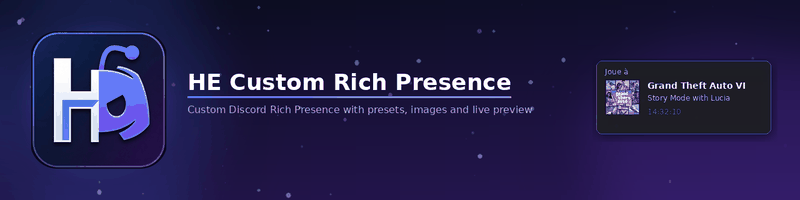
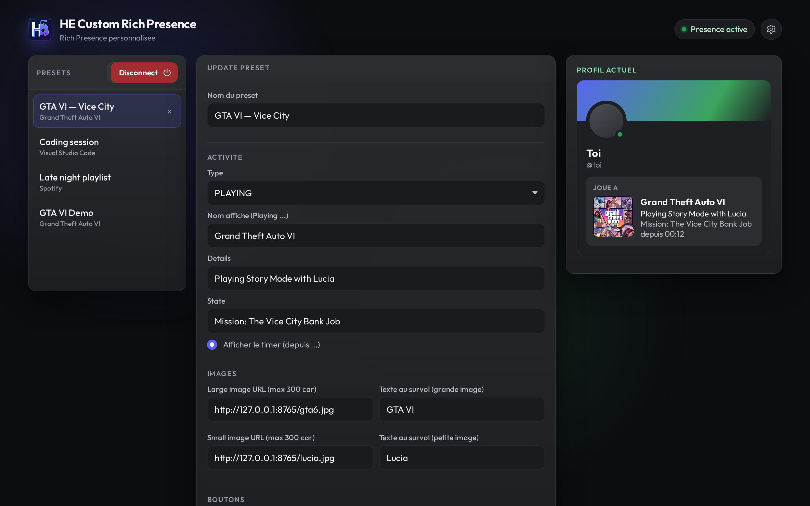
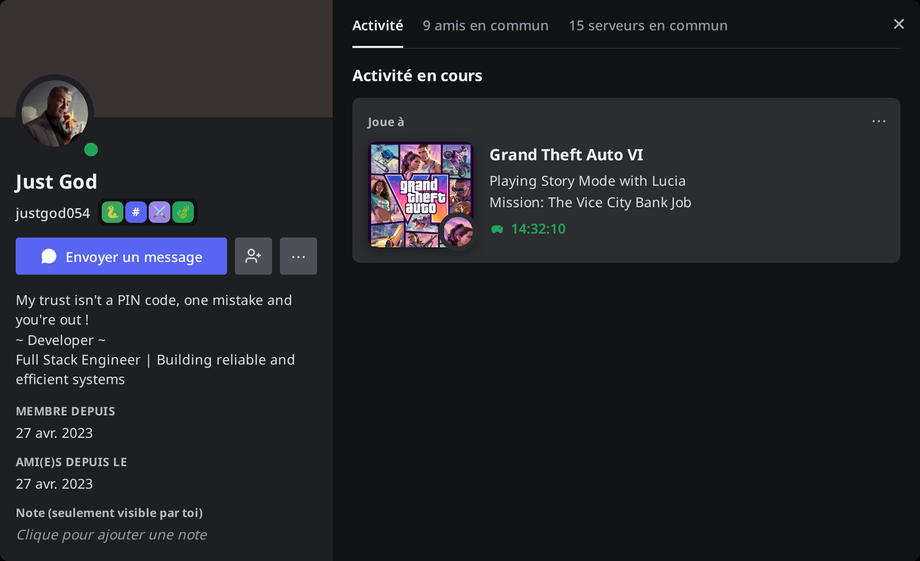
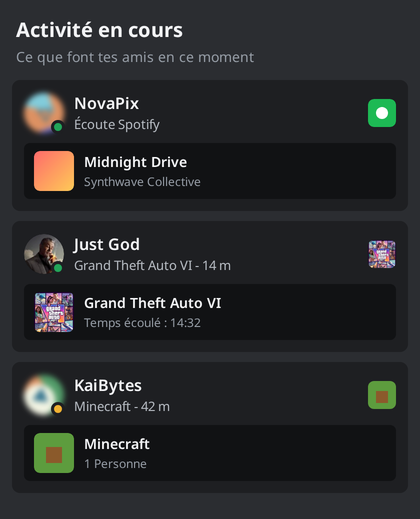
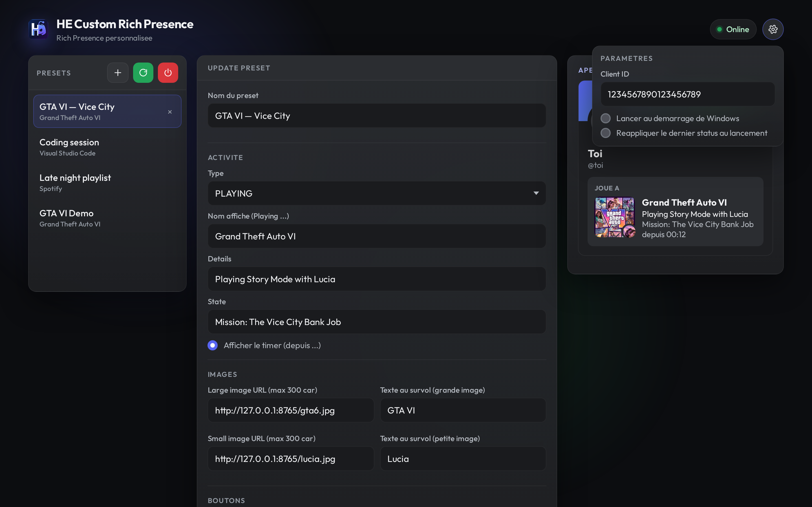
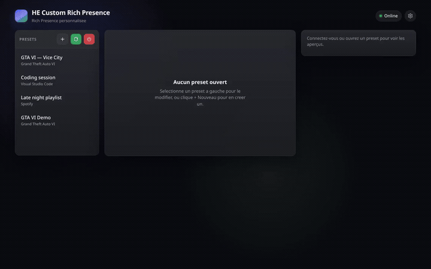

<p align="center"></p>

<p align="center">
  <a href="https://github.com/hugoegry"></a>
  &nbsp;
  <a href="mailto:hugo.egry@epitech.eu"></a>
  &nbsp;
  <a href="https://github.com/hugoegry?tab=stars"></a>
</p>

<h2 align="center">A Windows desktop app to craft a <strong>custom Discord Rich Presence</strong>: presets, images, buttons, timer, and a live profile preview.</h2>
<br>

<div align="center">

<p align="center">
  
  
  
  
  
  
</p>

[Features](#features) • [Discord setup](#discord-developer-portal-setup) • [Configuration](#configuration) • [Install](#getting-started) • [Build](#build-windows-exe) • [Team](#contributors) • [Demo](#demo) • [License](#license)

</div>
<br>

---

## About The Project

<p align="center"></p>

**HE Custom Rich Presence** (`he-custom-rich-presence`) is a personal Windows tool that talks to the Discord desktop client over local IPC and pushes a Rich Presence of your choice: activity type (Playing / Listening / Watching / Competing), custom name, details, state, large/small images, hover text, optional elapsed timer, and up to two buttons.

The UI is a local React app served by Flask and wrapped in a pywebview window. Presets are saved on disk so you can switch profiles in one click. An in-app preview shows roughly how the status will look on your Discord profile.

<p align="center"></p>

---

## Features

- Create, edit, delete and switch **presets**
- Activity types: `PLAYING`, `LISTENING`, `WATCHING`, `COMPETING`
- Custom **displayed name**, details and state lines
- **Large / small images** via Discord Art Asset keys **or** direct `https://…jpg/png` URLs (max 300 characters)
- Optional **elapsed timer**
- Up to **two buttons** (label + URL)
- Live **profile preview** in the app
- **Connect / Update / Disconnect** against Discord desktop
- Settings: Application ID, launch at Windows startup, re-apply last presence on launch
- Local security: bind on `127.0.0.1`, session token on `/api/*`, single-instance lock, auto port `8765`–`8784`

<p align="center">
  
</p>

<p align="center">
  
</p>

---

## Example: how it looks on Discord

Below is a **from-scratch render** of a Discord dark UI (French labels), using the example presence:

| Field | Value |
|---|---|
| Activity | Playing **Grand Theft Auto VI** |
| Details | Playing Story Mode with Lucia |
| State | Mission: The Vice City Bank Job |
| Large image | GTA VI official cover art |

<p align="center"></p>

<p align="center"></p>

---

## Discord Developer Portal setup

Discord must be running as the **desktop app** (not only the browser). Your activity privacy must allow sharing: **User Settings → Activity Privacy → Share your activity** (*Partager mon activité*).

### 1. Create an application

1. Open [discord.com/developers/applications](https://discord.com/developers/applications) and log in.
2. **New Application** — the **application name** is what friends see as the game / activity title if you leave the in-app “Nom affiché” empty; you can still override the displayed name from the app.
3. Open the app → **General Information**.

### 2. Application ID (required)

Copy the **Application ID** (also called Client ID). Paste it in the app under **Paramètres → Client ID**.

This is the only Discord credential this project needs. It is used by `pypresence` to open a local IPC session with Discord desktop.

### 3. Public Key (not used by this app)

On the same **General Information** page you will also see a **Public Key**.  
**HE Custom Rich Presence does not read or need the Public Key.** That key is for verifying HTTP interaction / webhook signatures (slash commands, etc.). You can ignore it for Rich Presence.

There is also **no bot token** required for this workflow.

### 4. Rich Presence art assets (optional)

If you prefer asset keys over raw image URLs:

1. Left sidebar → **Rich Presence → Art Assets**
2. Upload images (min 512×512 recommended)
3. Note the **asset key** (the name you give the upload)
4. Put that key in the app’s **Large image** / **Small image** fields

Alternatively, paste a **short direct image URL** (must be under 300 characters, ideally ending in `.jpg` / `.png`). Google result pages are rejected; the app tries to unwrap `imgurl=` when possible.

### 5. Apply the presence

1. Start Discord desktop and this app
2. Set the Client ID in settings
3. Create or open a preset, fill the fields
4. Click **Connect** (first time) or **Update**

<p align="center"></p>

---

## Configuration

User data (dev = project root, packaged exe = `%LOCALAPPDATA%\he-custom-rich-presence\`):

| File | Role |
|---|---|
| `config.json` | `client_id`, `launch_at_startup`, `auto_apply_on_launch`, `last_presence` |
| `presets.json` | Saved presets |
| `.local_session` | Ephemeral session token + bound port (dev / Vite) |
| `instance.lock` | Single-instance PID lock |

See `config.example.json` and `presets.example.json`. Real `config.json` / `presets.json` are gitignored.

### Presence payload fields

| Key | Meaning |
|---|---|
| `activity_type` | `PLAYING` / `LISTENING` / `WATCHING` / `COMPETING` |
| `activity_name` | Displayed activity name (sent to Discord as `name`) |
| `details` | First status line |
| `state` | Second status line |
| `large_image` / `small_image` | Art asset key or direct URL (≤ 300 chars) |
| `large_text` / `small_text` | Hover tooltips |
| `timer` | If true, start an elapsed timer |
| `button1_label` / `button1_url` | Optional button (max 2) |
| `button2_label` / `button2_url` | Optional button |

---

## Getting Started

### Requirements

- Windows 10/11
- Discord desktop installed and running
- For source: **Python 3.11+**, **Node.js 18+**

### Run the packaged app

From a Release (or your local `dist\he-custom-rich-presence\` build), keep the whole folder and run:

```text
he-custom-rich-presence.exe
```

### Run from source

```powershell
git clone https://github.com/hugoegry/HE-Custom-Rich-Presence.git
cd HE-Custom-Rich-Presence

python -m venv .venv
.\.venv\Scripts\Activate.ps1
pip install -r requirements.txt

cd frontend
npm install
npm run build
cd ..

python desktop.py
```

Hot-reload frontend (order matters):

1. `python app.py` (writes `.local_session` with token + port)
2. `cd frontend ; npm run dev` (Vite reads the session file at startup)

---

## Build (Windows .exe)

```powershell
.\.venv\Scripts\Activate.ps1
.\build_exe.ps1
```

Output: `dist\he-custom-rich-presence\he-custom-rich-presence.exe` (ship the entire folder).  
UPX is disabled in the PyInstaller spec to reduce antivirus false positives.

---

## Project structure

```
├── app.py                 Flask API + static UI server
├── desktop.py             pywebview shell
├── rpc_client.py          pypresence wrapper
├── branding.py            display / code names
├── paths.py               dev vs frozen paths, ports
├── local_security.py      session token + host checks
├── instance_lock.py       single instance
├── startup_win.py         Windows startup shortcut
├── build_exe.ps1          frontend build + PyInstaller
├── he-custom-rich-presence.spec
├── requirements.txt
├── frontend/              React + Vite + SCSS UI
│   └── src/features/presence/
└── assets/app.ico
```

---

## Tech stack

| Layer | Tech |
|---|---|
| Desktop shell | Python, pywebview |
| Local API | Flask (127.0.0.1) |
| Discord IPC | pypresence |
| UI | React, TypeScript, Vite, SCSS |
| Packaging | PyInstaller (Windows) |

---

## Contributors

<div align="center">
<table>
  <tr><th>Avatar</th><th>Name</th><th>Role</th><th>GitHub</th></tr>
  <tr>
    <td align="center"></td>
    <td><b>Hugo Egry</b></td>
    <td>Author</td>
    <td><a href="https://github.com/hugoegry">@hugoegry</a></td>
  </tr>
</table>
</div>

---

## Demo

A short session in the app: open settings, set the Application ID, create a GTA VI preset, fill details / image, save, then connect (presence goes live in the preview).

<p align="center"></p>

<p align="center"><a href="assets/demo/demo.mp4">Watch the full-quality video (MP4)</a></p>

---

## License

See [`LICENSE`](LICENSE).

Personal / legitimate use only. **Illegal, fraudulent, deceptive, or Discord ToS-violating use is forbidden.**  
Not affiliated with Discord. You are responsible for your Client ID and for everything you show in Rich Presence (text, images, buttons, links).

<!--HEG_GIT_HUB_API
[
  {
    "name": "HE Custom Rich Presence",
    "desc": "A Windows desktop app to craft a custom Discord Rich Presence: presets, images, buttons, timer, and a live profile preview. Built with Python, Flask, React, Vite, pypresence and pywebview.",
    "date": "2026-11-05T14:00:00Z",
    "link": {
      "codeReview": "https://github.com/hugoegry/Custom-Rich-Presence--Custom-Discord-Status-",
      "show": null
    },
    "preview": {
      "p1": {
        "name": "miniatureHeCustomRichPresence",
        "ex": "jpg"
      },
      "p2": {
        "name": "heCustomRichPresenceImg1",
        "ex": "jpg"
      },
      "p3": {
        "name": "heCustomRichPresenceImg2",
        "ex": "jpg"
      }
    }
  }
]
-->